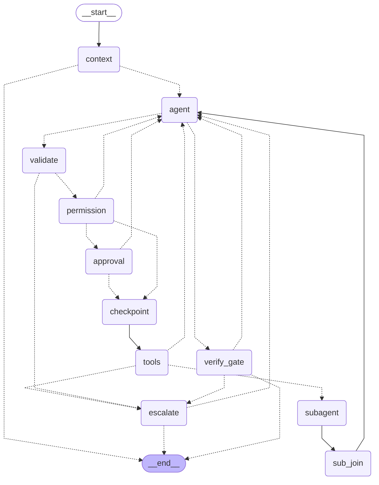

# CAP — Code As Planned

A terminal coding agent built on [LangGraph](https://github.com/langchain-ai/langgraph). It reads your code, edits it, runs commands and tests, and only says "done" after the tests actually pass. It works with any OpenAI-compatible model — OpenAI, Anthropic, Gemini, OpenRouter, or a local model in Ollama / LM Studio.

CAP was designed and measured with a small model (a 9B model with a 16k context window), so it leans on guard rails instead of trusting the model: a permission table, approvals, an OS sandbox, checkpoints, and a test gate.

## Install

```powershell
uv tool install git+https://github.com/juyoung020/cap-agent     # or: pipx install git+https://github.com/juyoung020/cap-agent
cap setup            # choose a model provider, enter a key, pick a model — CAP makes one test call before saving
cap sandbox setup    # one-time: command sandbox (Windows: AppContainer, no WSL, no admin)
cd your-project
cap
```

Python 3.10+ and git are needed. CAP is developed and tested on Windows 11; Linux works with the Landlock sandbox. macOS is not supported.

| Provider (`cap setup`) | Key |
|---|---|
| `openai`, `anthropic`, `gemini`, `openrouter` | the provider's API key (or `OPENAI_API_KEY`, `ANTHROPIC_API_KEY`, `GEMINI_API_KEY`, `OPENROUTER_API_KEY`) |
| `ollama`, `lmstudio` | none — runs on your computer |
| `custom` | any OpenAI-compatible URL (`CAP_CUSTOM_API_KEY`) |

Keys are saved to `~/.cap/auth.json`, readable only by your account. Environment variables win over saved keys. Switch later with `cap setup` or `/provider` in the chat.

## Use

Type a task: "fix the failing test in calc.py", "add a --verbose flag". CAP plans, reads files, edits, runs the tests, and reports.

- **Modes** (Shift+Tab): `chat` (read only) · `ask` (approve each edit and command, default) · `plan` (plan first, then approve) · `auto` (only risky actions ask) · `bypass`.
- **Approvals** appear in place of the input box: *Yes* · *Yes, don't ask again this session* · *Yes, don't ask again in this project* · *No, and tell CAP what to do instead*.
- **Commands**: `/review` `/commit` `/undo` `/rewind` `/continue` `/resume` `/fork` `/compact` `/plan` `/goal` `/task` `/skills` `/mcp` `/plugins` `/permissions` `/sandbox` `/provider` `/config` `/doctor` … (`/help`).
- **Long-running jobs**: `cap go "task" --detach --until 08:00` splits a spec into stages and works through them while you are away. Each stage gets a fresh context, writes and locks its tests first, retries with a different approach, re-checks earlier stages and commits on a work branch. Anything that needs you goes to a question box (`cap inbox`, optional phone notifications) while other stages keep running; the final report re-runs every check. `cap go status` shows one status line.
- **Scripts and CI**: `cap exec "task"`, `--json` (one result line), `--events` (JSONL progress, like `codex exec --json`), `--schema file.json`, `--max-turns N`, `-o last.txt`, `cap exec resume last "follow-up"`.
- **From another agent**: `cap mcp-server` exposes a `run_task` MCP tool. The repository is also a Claude Code / Codex plugin.

Project instructions go in `CAP.md`, read like Claude Code's `CLAUDE.md`: `CAP.md` (shared), `CAP.local.md` (personal, keep it out of git), `~/.cap/CAP.md` (all projects), and `CAP.md` in subfolders when CAP first touches files there. `AGENTS.md` and `CLAUDE.md` are read too; CAP's own file comes last and wins.

CAP reads Claude Code and Codex configuration in place: skills (`.claude/skills`, `~/.codex/skills`), commands, sub-agents, hooks (including `hookSpecificOutput` decisions), MCP servers (tools, resources, prompts) and plugins. Foreign hooks and MCP servers stay off until you enable them, and project-level ones need `/hooks trust` / `/mcp trust`.

## Safety

| Guard | What it does |
|---|---|
| Permission table | Every tool call is classified allow / ask / deny before it runs. Writing outside the workspace, reading secret files and destructive commands are refused in every mode. Agent instructions, existing tests and installs always need a human. |
| Sandbox | Commands the model runs are isolated by the OS. **Windows**: AppContainer — reads and writes only inside the workspace, no network; the shell is `cmd.exe` (Git Bash and PowerShell do not start inside an AppContainer) with common Unix commands added by CAP (`ls cat head tail grep wc find rm cp mv mkdir -p touch diff`); `$VAR` is translated and multi-line commands, `python -c` bodies and heredocs are run line by line or from a file, but bash syntax such as `$(...)` or `for` loops is not available. **Linux**: Landlock — writes only in the workspace and `/tmp`, no TCP. Running something outside the sandbox always asks you. |
| Test gate | Before a turn ends, the harness runs the project's tests itself. A failing test sends the output back to the model; "done" with failing tests is not accepted. After six code edits in a row without a test run, the harness also runs the tests mid-turn and appends the result to the tool output, at no extra model call. |
| Checkpoints | Every graph step is checkpointed (SQLite). `/continue` resumes a turn that stopped midway (crash, error, Esc) from its last step; `/undo` and `/rewind` restore files from a shadow git snapshot. |
| Secrets | Key-like values are masked in everything the model sees; secret files are never read. |

## How it works

Each request runs this LangGraph graph (generated from the compiled graph with `cap loop-graph`; dashed = conditional edges):



`approval` and `escalate` pause with `interrupt()` and resume with `Command(resume=…)`, so a pending approval survives a restart. `subagent` runs delegated tasks in parallel with `Send`.

## Status

- Measured on Windows 11 with `qwen3.5-9b` (16k context): on 11 multi-file tasks (bugs whose cause is in another module, a feature across 6 files, API changes with hidden call sites, an 826-line file, refactoring), CAP passed 17 of 22 over two runs and handed the rest to a human, with no false "done"; a single model call without the agent loop passed 1 of 11 and returned broken code for the other 10. Prompt-injection and escape scenarios (10 cases): no harm with the sandbox on.
- Compared with Aider 0.86.2 (Aider-AI) on the same model, four of those tasks, one run each: CAP 4/4, Aider 2/4 (the other two stopped at its limit of three fix attempts); neither reported a false "done". Four tasks and one run show a direction, not a margin.
- Also run on a copy of a real research repository (267 files, 53 tests); the problems found there were fixed.
- Tests run on Windows and Linux (Python 3.11, 3.12) in GitHub Actions.
- Other providers were tested against a fake OpenAI-compatible server, not with real keys.
- 539 tests: `python -m pytest -q tests` (no API calls).

## License

[Apache License 2.0](LICENSE)
